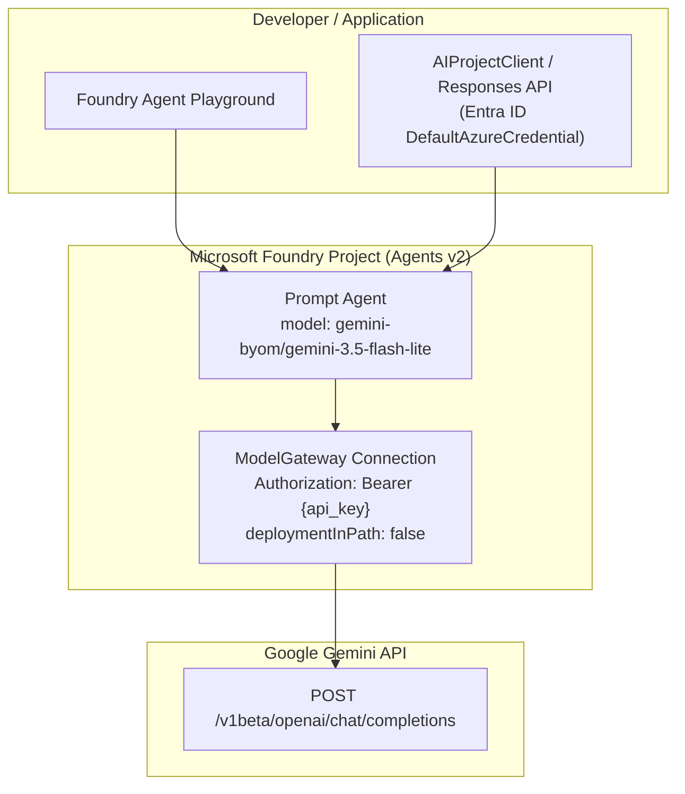

# Connect Google Gemini Models to Microsoft Foundry (BYOM)

A complete, step-by-step guide and reproducible toolkit for connecting **Google Gemini** models to **Microsoft Foundry** (formerly Azure AI Foundry) using **Bring Your Own Model (BYOM)** (`ModelGateway` connections) with **Foundry Agent Service (Agents v2)**.

---

## Why BYOM Is Required for Gemini

Unlike OpenAI, Anthropic Claude, Meta Llama, Mistral, or Cohere, **Google Gemini models are not hosted natively as serverless or managed compute inside the Microsoft Foundry Model Catalog**. Gemini continues to run on Google infrastructure (Google AI Studio or Vertex AI).

Microsoft Foundry bridges this cleanly through **Connected Models (BYOM)**:

- Google exposes an **OpenAI-compatible Chat Completions endpoint** (`https://generativelanguage.googleapis.com/v1beta/openai`).
- Foundry's **`ModelGateway`** connection securely stores your upstream credentials, maps static Gemini model IDs into your Foundry project, and exposes them to **Foundry Agents v2** (`PromptAgentDefinition`, Agent Playground, and the Foundry `Responses` API) using the `<connection-name>/<model-name>` convention.

---

## Architecture Overview



> **Production Option (Enterprise AI Gateway):** For production workloads that require keyless Managed Identity authentication end-to-end, token rate-limiting, semantic caching, or Azure AI Content Safety guardrails, place **Azure API Management (AI Gateway)** between Microsoft Foundry and Google Gemini (see [Section 6: Production Architecture with Azure API Management](#6-production-architecture-with-azure-api-management)).

---

## Repository Contents

| Path | Purpose |
|---|---|
| [`README.md`](./README.md) | End-to-end Portal, CLI/ARM, SDK, and troubleshooting tutorial |
| [`infra/model-gateway-connection.json`](./infra/model-gateway-connection.json) | Declarative ARM template to deploy the Foundry `ModelGateway` connection |
| [`scripts/Invoke-FoundryGeminiSmokeTest.ps1`](./scripts/Invoke-FoundryGeminiSmokeTest.ps1) | Zero-dependency PowerShell smoke test (creates a temp agent, invokes Gemini, and cleans up) |
| [`scripts/smoke_test.py`](./scripts/smoke_test.py) | Python `azure-ai-projects` v2 smoke test using `DefaultAzureCredential` |
| [`requirements.txt`](./requirements.txt) | Python SDK dependencies |
| [`.env.example`](./.env.example) | Environment variable template for local SDK testing |

---

## Prerequisites

1. **Azure Subscription & Microsoft Foundry Project**
   - An existing **Microsoft Foundry** resource (`Microsoft.CognitiveServices/accounts`, kind `AIServices`) and a **Project** in [Microsoft Foundry](https://ai.azure.com).
   - **RBAC**: Your Entra ID identity needs **Azure AI User** (or **Cognitive Services User**) on the Foundry resource/project to create and invoke agents.
2. **Google AI Studio API Key**
   - Create a Gemini API key in [Google AI Studio](https://aistudio.google.com/apikey).
3. **Local Tools (Optional, for CLI / Script Verification)**
   - [Azure CLI](https://learn.microsoft.com/cli/azure/install-azure-cli) (`az login`)
   - PowerShell 7+ or Python 3.10+

---

## 1. Preflight Check: Verify Your Gemini Key & Active Model IDs First

Before wiring the connection in Azure, verify your Gemini API key and check which Gemini model IDs respond immediately on your Google AI Studio account.

> **Why this saves hours:**
> - Legacy 2.5 model IDs (such as `gemini-2.5-flash`) return **`HTTP 404`** on new Google AI Studio accounts.
> - Frontier reasoning tiers (such as `gemini-3.8-flash` or `gemini-4-hydrogen`) occasionally return **`HTTP 503 UNAVAILABLE`** during peak demand spikes. When that happens behind Foundry, Foundry's `ModelGateway` retries upstream `503`/`429` responses until its **100-second timeout** expires, surfacing a confusing `HTTP 408 RequestTimedOut` instead of Google's `503` message.

### PowerShell Preflight

```powershell
$env:GEMINI_API_KEY = "<your-gemini-api-key>"

foreach ($model in @("gemini-3.5-flash-lite", "gemini-3.6-flash", "gemini-3.8-flash")) {
  try {
    $res = Invoke-RestMethod -Method Post `
      -Uri "https://generativelanguage.googleapis.com/v1beta/openai/chat/completions" `
      -Headers @{ Authorization = "Bearer $env:GEMINI_API_KEY" } `
      -ContentType "application/json" `
      -Body "{`"model`":`"$model`",`"messages`":[{`"role`":`"user`",`"content`":`"Say Pong.`"}]}" `
      -ErrorAction Stop
    Write-Host "SUCCESS [$model]: $($res.choices[0].message.content)" -ForegroundColor Green
  } catch {
    $code = if ($_.Exception.Response) { [int]$_.Exception.Response.StatusCode } else { "ERR" }
    Write-Host "FAIL    [$model]: HTTP $code" -ForegroundColor Yellow
  }
}
```

### Bash / `curl` Preflight

```bash
export GEMINI_API_KEY="<your-gemini-api-key>"

for model in gemini-3.5-flash-lite gemini-3.6-flash gemini-3.8-flash; do
  echo "=== Testing $model ==="
  curl -sS -w "\nHTTP %{http_code}\n" \
    "https://generativelanguage.googleapis.com/v1beta/openai/chat/completions" \
    -H "Content-Type: application/json" \
    -H "Authorization: Bearer $GEMINI_API_KEY" \
    -d "{\"model\":\"$model\",\"messages\":[{\"role\":\"user\",\"content\":\"Say Pong.\"}]}"
done
```

Pick at least one model that returns `HTTP 200` immediately:
- **`gemini-3.5-flash-lite`** — Best for fast smoke testing and high-throughput free-tier limits.
- **`gemini-3.6-flash`** / **`gemini-3.8-flash`** — Best for deeper multi-step reasoning and tool use.

---

## 2. Step-by-Step Setup in the Microsoft Foundry Portal

1. **Open Connections**
   - Sign in to [Microsoft Foundry](https://ai.azure.com) and open your **Project** (or parent Foundry resource).
   - In the left navigation (or **Management center**), select **Connections** → **+ Add connection** → **Model**.

2. **Select Compatible Endpoint (`ModelGateway`)**
   - Choose **OpenAI** (or the compatible external endpoint / **Model Gateway** option shown in the connection chooser).

3. **Configure Endpoint & Routing Exactly as Below**

   | Field | Exact Value | Why It Matters |
   |---|---|---|
   | **Connection name** | `gemini-byom` *(or your preferred name)* | Used as the prefix `<connection-name>/<model-name>` |
   | **Base URL** | `https://generativelanguage.googleapis.com/v1beta/openai` | **Do not** append `/chat/completions` — Foundry appends it automatically |
   | **Use the Responses API for upstream requests** | **Unchecked / Off** | Google's compatibility endpoint implements `/chat/completions`, not `/responses` |
   | **Advanced → Include deployment name in URL path** | **Disabled (`false`)** | Google routes via `"model"` in the JSON body, not `/deployments/{name}` |
   | **Advanced → API version** | *(leave blank)* | Google's endpoint does not accept Azure `?api-version=` query strings |

4. **Configure Authentication (Critical)**
   - **Authentication type**: **API key**
   - **API key**: `<your-gemini-api-key>`
   - **API key header name**: `Authorization`
   - **API key header value**: `Bearer {api_key}`

   > ⚠️ **Common Pitfall:** Do **not** leave the header name as `x-api-key` or the format as `{api_key}`. Google's `/v1beta/openai/chat/completions` endpoint strictly requires `Authorization: Bearer <key>` and rejects `x-api-key` with `HTTP 400: Missing or invalid Authorization header.`

5. **Add Static Gemini Models**
   - On the **Model configuration** page, click **+ Add model** and register each model ID **without** a `models/` prefix:
     - **Model 1**: Name = `gemini-3.5-flash-lite`, Display name = `Gemini 3.5 Flash-Lite`
     - **Model 2**: Name = `gemini-3.6-flash`, Display name = `Gemini 3.6 Flash`
   - Click **Save**.

6. **Choose Scope & Save Connection**
   - Select **Project** scope (or **Resource** scope with project sharing enabled) and click **Add / Save**.

---

## 3. Infrastructure-as-Code Setup (ARM Template + Azure CLI)

Prefer repeatable CLI deployments over portal clicks: use [`infra/model-gateway-connection.json`](./infra/model-gateway-connection.json) to provision the exact `ModelGateway` connection configuration.

### Bash

```bash
export RESOURCE_GROUP="<your-resource-group>"
export FOUNDRY_ACCOUNT="<your-foundry-resource>"
export FOUNDRY_PROJECT="<your-project-name>"   # Optional: leave "" for resource-wide scope
export GEMINI_API_KEY="<your-gemini-api-key>"

az deployment group create \
  --resource-group "$RESOURCE_GROUP" \
  --template-file infra/model-gateway-connection.json \
  --parameters \
    foundryAccountName="$FOUNDRY_ACCOUNT" \
    foundryProjectName="$FOUNDRY_PROJECT" \
    connectionName="gemini-byom" \
    geminiApiKey="$GEMINI_API_KEY"
```

### PowerShell

```powershell
$ResourceGroup       = "<your-resource-group>"
$FoundryAccount      = "<your-foundry-resource>"
$FoundryProject      = "<your-project-name>"   # Optional: "" for resource-wide scope
$env:GEMINI_API_KEY  = "<your-gemini-api-key>"

az deployment group create `
  --resource-group $ResourceGroup `
  --template-file .\infra\model-gateway-connection.json `
  --parameters `
    foundryAccountName="$FoundryAccount" `
    foundryProjectName="$FoundryProject" `
    connectionName="gemini-byom" `
    geminiApiKey="$env:GEMINI_API_KEY"
```

---

## 4. Test & Invoke the Connected Gemini Model

### Option A: No-Code Test in Foundry Agent Playground (~30 Seconds)

> **Important:** Connected (BYOM) models work in **Agents (v2)**—they do **not** appear in the classic standalone Model Chat Playground.

1. In [Microsoft Foundry](https://ai.azure.com), open your **Project**.
2. Go to **Agents** → **+ New agent** (or open **Agent Playground**).
3. In the **Model** dropdown, select **`gemini-byom/gemini-3.5-flash-lite`** (or its display name).
4. Send a test prompt:
   ```text
   Reply in one short sentence confirming which Gemini model you are.
   ```

### Option B: PowerShell End-to-End Smoke Test (No Extra Packages)

Sign in with `az login`, then run [`scripts/Invoke-FoundryGeminiSmokeTest.ps1`](./scripts/Invoke-FoundryGeminiSmokeTest.ps1):

```powershell
.\scripts\Invoke-FoundryGeminiSmokeTest.ps1 `
  -ProjectEndpoint "https://<your-foundry-resource>.services.ai.azure.com/api/projects/<your-project-name>" `
  -ConnectionName "gemini-byom" `
  -ModelName "gemini-3.5-flash-lite"
```

Expected output:

```text
Acquiring Microsoft Foundry Entra ID token via Azure CLI...
Creating temporary Prompt Agent 'gemini-byom-smoke-test' -> 'gemini-byom/gemini-3.5-flash-lite'...
Created 'gemini-byom-smoke-test' v1. Sending test prompt...

SUCCESS in 4186 ms (status: completed)
Model : gemini-byom/gemini-3.5-flash-lite
Reply : Pong, I confirm I am Gemini 3.5 Flash Lite responding via Microsoft Foundry.
Usage : input=43, output=18, total=61
Cleaned up temporary agent 'gemini-byom-smoke-test' v1.
```

### Option C: Python SDK (`azure-ai-projects` v2)

1. Sign in with `az login`, install dependencies, and copy `.env.example` to `.env`:

   **PowerShell (Windows)**
   ```powershell
   python -m venv .venv
   .\.venv\Scripts\Activate.ps1
   pip install -r requirements.txt
   Copy-Item .env.example .env
   ```

   **Bash (Linux / macOS)**
   ```bash
   python3 -m venv .venv
   source .venv/bin/activate
   pip install -r requirements.txt
   cp .env.example .env
   ```

2. Edit `.env` with your `FOUNDRY_PROJECT_ENDPOINT` and `FOUNDRY_MODEL_DEPLOYMENT=gemini-byom/gemini-3.5-flash-lite`.
3. Run [`scripts/smoke_test.py`](./scripts/smoke_test.py):
   ```bash
   python scripts/smoke_test.py
   ```

---

## 5. Known Platform Limitations for BYOM Connections

When using any external BYOM model in Microsoft Foundry, keep these current platform boundaries in mind:

- **Supported surface**: Foundry **Agents v2** (`PromptAgentDefinition` and the project `/openai/responses` endpoint). Direct calls to `/openai/v1/chat/completions` on the Foundry resource do **not** route to `ModelGateway` connections.
- **Model identifier format**: Always pass `<connection-name>/<model-name>` (for example, `gemini-byom/gemini-3.5-flash-lite`), never `<model-name>` alone.
- **Unsupported Foundry add-ons on BYOM**:
  - Native **Foundry Guardrails** (`x-policy-id`)
  - **Foundry IQ**, **Agent Memory**, **Agent Optimizer**, and **Synthetic Data Generation**
  - **Managed Copilot Harness**
  - Passing `reasoning.effort` through the Foundry `Responses` API (`Unsupported parameter: 'reasoning.effort' is not supported with this model`)

---

## 6. Production Architecture with Azure API Management

Because native Foundry Guardrails do not run on external BYOM endpoints, Microsoft recommends placing **Azure API Management (AI Gateway)** in front of Google Gemini for production workloads:

1. In **Azure API Management** → **APIs** → **+ Add API** → **Language Model API**:
   - **URL**: `https://generativelanguage.googleapis.com/v1beta/openai`
   - **Type**: **Create OpenAI API**
   - **Access key**: Header `Authorization`, Value `Bearer <your-gemini-api-key>` (stored as an encrypted APIM Named Value).
2. Attach APIM AI Gateway policies:
   - `validate-azure-ad-token` (keyless Managed Identity auth from your Foundry project)
   - `llm-content-safety` (enforces **Azure AI Content Safety** input/output filtering)
   - `llm-token-limit` and `llm-semantic-cache` (cost and rate governance)
3. In **Microsoft Foundry** → **Connections** → **Add connection** → **Model** → **Azure API Management / AI Gateway**, connect your APIM gateway using the Foundry project's **System-Assigned Managed Identity**.

> **Need Gemini-native tools (Google Search/Maps grounding, Vertex AI IAM, or `ThinkingConfig` thought summaries)?** Deploy a containerized **Foundry Hosted Agent** (`kind: hosted`) using the [Microsoft Agent Framework Gemini provider](https://learn.microsoft.com/agent-framework/integrations/by-component/model-providers/google-gemini) (`pip install agent-framework-gemini --pre`).

---

## 7. Real-World Troubleshooting Matrix

| Symptom / Error | Root Cause | Exact Fix |
|---|---|---|
| `HTTP 400` — `Missing or invalid Authorization header.` (`INVALID_ARGUMENT`) | Connection `authConfig` uses `x-api-key` or `{api_key}` without `Bearer ` | Edit the connection → set **API key header name** = `Authorization` and **API key header value** = `Bearer {api_key}` |
| `HTTP 404` — `DeploymentNotFound` / `model not found` (immediately from Foundry) | Model string omitted `<connection-name>/` or called `/openai/v1/chat/completions` directly | Invoke via Foundry Agents v2 / Project `Responses` API and pass `<connection-name>/<model-name>` |
| `HTTP 404` — `This model models/gemini-2.5-flash is no longer available to new users.` | Google retired 2.5 models for new Google AI Studio accounts | Add an active Gemini model (`gemini-3.5-flash-lite`, `gemini-3.6-flash`, or `gemini-3.8-flash`) without `models/` prefix |
| `HTTP 408` — `RequestTimedOut` after **`~100 seconds`** (`ModelGateway response: The operation was canceled.`) | Upstream Google returned **`HTTP 503 UNAVAILABLE`** (demand spike) or **`HTTP 429 RESOURCE_EXHAUSTED`** (free-tier RPM/RPD limit or `$0` prepay balance); Foundry `ModelGateway` retries `429`/`503` until its 100s timeout | Run the [Section 1 Preflight Check](#1-preflight-check-verify-your-gemini-key--active-model-ids-first) locally to see Google's raw `429`/`503`, verify Google AI Studio quota/prepay balance, and add `gemini-3.5-flash-lite` |
| `HTTP 400` — `Unsupported parameter: 'reasoning.effort' is not supported with this model.` | Foundry BYOM proxy rejects `reasoning.effort` on `ModelGateway` connections | Remove `reasoning` / `reasoning_effort` from the `PromptAgentDefinition` and `responses.create()` payload |
| Connection works at Account level, but model is missing in Project | Resource-scope connection created with project sharing disabled (`isSharedToAll: false`) | Enable project sharing on the connection or create the connection directly inside the target Foundry Project |

---

## Official References

- [Connect models to Microsoft Foundry Agent Service](https://learn.microsoft.com/azure/foundry/agents/how-to/connected-models)
- [Bring your own model (BYOM) to Foundry Agent Service](https://learn.microsoft.com/azure/foundry/agents/how-to/ai-gateway)
- [Import an OpenAI-compatible Google Gemini API in Azure API Management](https://learn.microsoft.com/azure/api-management/openai-compatible-google-gemini-api)
- [Microsoft Agent Framework — Google Gemini Provider](https://learn.microsoft.com/agent-framework/integrations/by-component/model-providers/google-gemini)
- [Google Gemini API — OpenAI Compatibility](https://ai.google.dev/gemini-api/docs/openai)

---

## License

Released under the [MIT License](./LICENSE).
