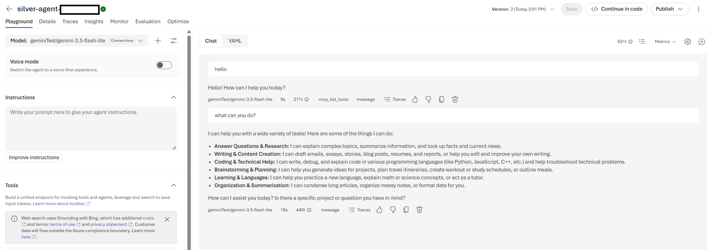

# Connect Google Gemini to Microsoft Foundry (BYOM)

Google Gemini isn't in the Microsoft Foundry model catalog, so it can't be deployed as a native Azure model. To use Gemini inside **Foundry Agents (v2)**, connect Google's OpenAI-compatible endpoint (`https://generativelanguage.googleapis.com/v1beta/openai`) as a **Model Gateway (BYOM)** connection and reference it as `<connection-name>/<model-name>`.



## Before You Start

- A **Microsoft Foundry** resource and project at [ai.azure.com](https://ai.azure.com), with the **Azure AI User** role on your account.
- A Gemini API key from [Google AI Studio](https://aistudio.google.com/apikey).
- Optional: [Azure CLI](https://learn.microsoft.com/cli/azure/install-azure-cli) (`az login`), PowerShell, or Python 3.10+ if you want to deploy or test from the terminal.

## 1. Add the Connection in Foundry

1. In [Microsoft Foundry](https://ai.azure.com), open your project and go to **Connections** → **+ Add connection** → **Model**.
2. Select **OpenAI** (or **Model Gateway** / compatible endpoint).
3. Fill in the connection settings using these exact values:

| Setting | Value | Notes |
|---|---|---|
| **Connection name** | `gemini-byom` | Prefix used when selecting the model (`gemini-byom/<model>`) |
| **Base URL** | `https://generativelanguage.googleapis.com/v1beta/openai` | Do **not** add `/chat/completions` — Foundry appends it |
| **Use the Responses API for upstream requests** | **Off** (unchecked) | Google's compatibility layer exposes `/chat/completions`, not `/responses` |
| **Authentication** | **API key** | Paste your Google AI Studio API key |
| **API key header name** | `Authorization` | Do **not** leave as `x-api-key` (Google rejects it with `HTTP 400`) |
| **API key header value** | `Bearer {api_key}` | Keep the `Bearer ` prefix and space |
| **Advanced → Include deployment name in URL path** | **Off** (`false`) | Google reads `"model"` from the JSON body, not `/deployments/{name}` |
| **Advanced → API version** | *(blank)* | Google rejects `?api-version=` query parameters |

4. Under **Model configuration**, click **+ Add model** and enter active Gemini model IDs **without** a `models/` prefix:
   - `gemini-3.5-flash-lite` — fast responses and higher free-tier quota (good default for testing)
   - `gemini-3.6-flash` or `gemini-3.8-flash` — stronger multi-step reasoning
5. Pick **Project** scope (or **Resource** scope with project sharing turned on) and save.

## 2. Test in Agent Playground

Connected (BYOM) models appear under **Agents (v2)** — they do **not** show up in the standalone classic Model Chat Playground.

1. Open your Foundry project → **Agents** → **+ New agent**.
2. In the **Model** dropdown, choose `gemini-byom/gemini-3.5-flash-lite`.
3. Send a quick prompt in the chat pane to confirm end-to-end routing and token metrics.

When calling the model from code, always pass the full `<connection-name>/<model-name>` string (for example, `gemini-byom/gemini-3.5-flash-lite`).

## 3. CLI Deployment & Code Examples (Optional)

<details>
<summary><strong>Check your Gemini API key directly before testing in Foundry</strong></summary>

If Foundry times out or returns an upstream error, test Google's endpoint directly first so you can see Google's raw HTTP status (`400`, `404`, `429`, or `503`) without Foundry's retry wrapper.

**Bash (`curl`)**
```bash
curl -sS -w "\nHTTP %{http_code}\n" \
  "https://generativelanguage.googleapis.com/v1beta/openai/chat/completions" \
  -H "Content-Type: application/json" \
  -H "Authorization: Bearer $GEMINI_API_KEY" \
  -d '{"model":"gemini-3.5-flash-lite","messages":[{"role":"user","content":"Say Pong."}]}'
```

**PowerShell**
```powershell
$env:GEMINI_API_KEY = "<your-gemini-api-key>"
Invoke-RestMethod -Method Post `
  -Uri "https://generativelanguage.googleapis.com/v1beta/openai/chat/completions" `
  -Headers @{ Authorization = "Bearer $env:GEMINI_API_KEY" } `
  -ContentType "application/json" `
  -Body '{"model":"gemini-3.5-flash-lite","messages":[{"role":"user","content":"Say Pong."}]}'
```

</details>

<details>
<summary><strong>Deploy the connection with Azure CLI (ARM template)</strong></summary>

[`infra/model-gateway-connection.json`](./infra/model-gateway-connection.json) creates the `ModelGateway` connection with `Authorization: Bearer {api_key}`, `deploymentInPath: false`, and static model mappings (`gemini-3.5-flash-lite`, `gemini-3.6-flash`). Leave `foundryProjectName` empty (`""`) if you want a resource-wide connection shared across all projects.

**Bash**
```bash
export RESOURCE_GROUP="<your-resource-group>"
export FOUNDRY_ACCOUNT="<your-foundry-resource>"
export FOUNDRY_PROJECT="<your-project-name>"
export GEMINI_API_KEY="<your-gemini-api-key>"

az deployment group create \
  --resource-group "$RESOURCE_GROUP" \
  --template-file infra/model-gateway-connection.json \
  --parameters \
    foundryAccountName="$FOUNDRY_ACCOUNT" \
    foundryProjectName="$FOUNDRY_PROJECT" \
    connectionName="gemini-byom" \
    geminiApiKey="$GEMINI_API_KEY"
```

**PowerShell**
```powershell
$ResourceGroup      = "<your-resource-group>"
$FoundryAccount     = "<your-foundry-resource>"
$FoundryProject     = "<your-project-name>"
$env:GEMINI_API_KEY = "<your-gemini-api-key>"

az deployment group create `
  --resource-group $ResourceGroup `
  --template-file .\infra\model-gateway-connection.json `
  --parameters `
    foundryAccountName="$FoundryAccount" `
    foundryProjectName="$FoundryProject" `
    connectionName="gemini-byom" `
    geminiApiKey="$env:GEMINI_API_KEY"
```

</details>

<details>
<summary><strong>Run the PowerShell smoke test</strong></summary>

[`scripts/Invoke-FoundryGeminiSmokeTest.ps1`](./scripts/Invoke-FoundryGeminiSmokeTest.ps1) acquires an Entra ID token from `az login`, creates a temporary Prompt Agent, sends one test prompt through the Foundry `Responses` API, prints latency and token usage, and deletes the temporary agent.

```powershell
.\scripts\Invoke-FoundryGeminiSmokeTest.ps1 `
  -ProjectEndpoint "https://<your-foundry-resource>.services.ai.azure.com/api/projects/<your-project-name>" `
  -ConnectionName "gemini-byom" `
  -ModelName "gemini-3.5-flash-lite"
```

</details>

<details>
<summary><strong>Run the Python SDK smoke test (<code>azure-ai-projects</code> v2)</strong></summary>

Sign in with `az login`, install [`requirements.txt`](./requirements.txt), set `FOUNDRY_PROJECT_ENDPOINT` and `FOUNDRY_MODEL_DEPLOYMENT` in `.env`, and run [`scripts/smoke_test.py`](./scripts/smoke_test.py).

**PowerShell (Windows)**
```powershell
python -m venv .venv
.\.venv\Scripts\Activate.ps1
pip install -r requirements.txt
Copy-Item .env.example .env
# Edit .env with your project endpoint and model string
python scripts/smoke_test.py
```

**Bash (Linux / macOS)**
```bash
python3 -m venv .venv
source .venv/bin/activate
pip install -r requirements.txt
cp .env.example .env
# Edit .env with your project endpoint and model string
python scripts/smoke_test.py
```

</details>

## 4. Troubleshooting

| Error | Cause | Fix |
|---|---|---|
| `HTTP 400` — `Missing or invalid Authorization header.` | Connection sends `x-api-key` or omits `Bearer ` | Edit the connection: set header name to `Authorization` and value to `Bearer {api_key}` |
| `HTTP 404` — `DeploymentNotFound` / `model not found` | Missing `<connection-name>/` prefix, or calling `/openai/v1/chat/completions` on the Foundry resource directly | Call through Foundry Agents v2 / Project `Responses` API and pass `<connection-name>/<model-name>` |
| `HTTP 404` — `models/gemini-2.5-flash is no longer available to new users` | Legacy 2.5 models are retired for new Google AI Studio accounts | Use `gemini-3.5-flash-lite`, `gemini-3.6-flash`, or `gemini-3.8-flash` (without `models/`) |
| `HTTP 408` — `RequestTimedOut` after ~100 seconds | Google returned `503 UNAVAILABLE` (capacity spike) or `429 RESOURCE_EXHAUSTED` (free-tier quota / `$0` prepay balance); Foundry retries `429`/`503` until its 100s timeout | Run the direct `curl` / PowerShell check in Section 3 to see Google's raw error, check AI Studio quota, or switch to `gemini-3.5-flash-lite` |
| `HTTP 400` — `'reasoning.effort' is not supported with this model` | Foundry's BYOM proxy rejects `reasoning.effort` on `ModelGateway` connections | Omit `reasoning` / `reasoning_effort` from the agent definition and request body |
| Connection saved on parent resource, but missing in project | Resource-level connection has project sharing disabled (`isSharedToAll: false`) | Enable project sharing on the connection, or create it inside the project |

## 5. Limitations & Production Notes

- **Agents v2 only:** BYOM connections work with Foundry Prompt Agents (`PromptAgentDefinition` and the project `/openai/responses` endpoint). They do not route through `/openai/v1/chat/completions` on the Foundry resource or the Managed Copilot Harness.
- **Foundry features not supported on BYOM:** Native Foundry Guardrails, Foundry IQ, Agent Memory, Agent Optimizer, and Synthetic Data Generation do not run on external `ModelGateway` connections.
- **Production governance (Azure API Management):** Because Foundry Guardrails don't run on BYOM endpoints, put **Azure API Management (AI Gateway)** between Foundry and Google Gemini for production workloads. Import `https://generativelanguage.googleapis.com/v1beta/openai` into APIM, attach Azure AI Content Safety (`llm-content-safety`), token limits (`llm-token-limit`), and Entra ID validation (`validate-azure-ad-token`), then connect Foundry to APIM with Managed Identity.
- **Vertex AI & native Gemini tools:** If you need Vertex AI IAM, Google Search/Maps grounding, or thought summaries (`ThinkingConfig`), deploy a containerized **Foundry Hosted Agent** (`kind: hosted`) with the [Microsoft Agent Framework Gemini provider](https://learn.microsoft.com/agent-framework/integrations/by-component/model-providers/google-gemini) (`pip install agent-framework-gemini --pre`).

## References

- [Connect models to Microsoft Foundry Agent Service](https://learn.microsoft.com/azure/foundry/agents/how-to/connected-models)
- [Bring your own model (BYOM) to Foundry Agent Service](https://learn.microsoft.com/azure/foundry/agents/how-to/ai-gateway)
- [Import an OpenAI-compatible Google Gemini API in Azure API Management](https://learn.microsoft.com/azure/api-management/openai-compatible-google-gemini-api)
- [Microsoft Agent Framework — Google Gemini provider](https://learn.microsoft.com/agent-framework/integrations/by-component/model-providers/google-gemini)
- [Google Gemini API — OpenAI compatibility](https://ai.google.dev/gemini-api/docs/openai)

## License

[MIT](./LICENSE)
